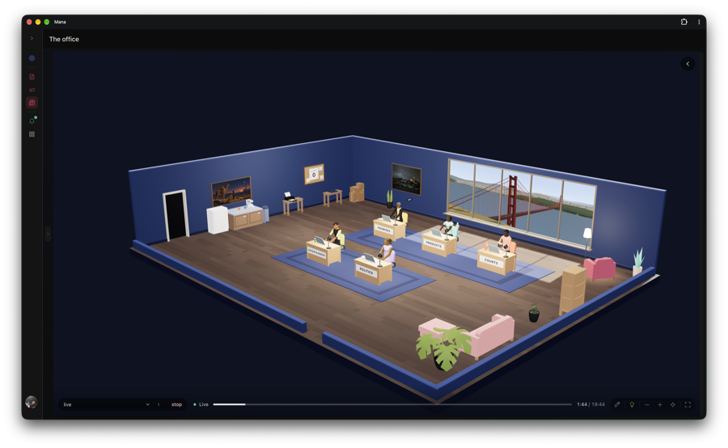
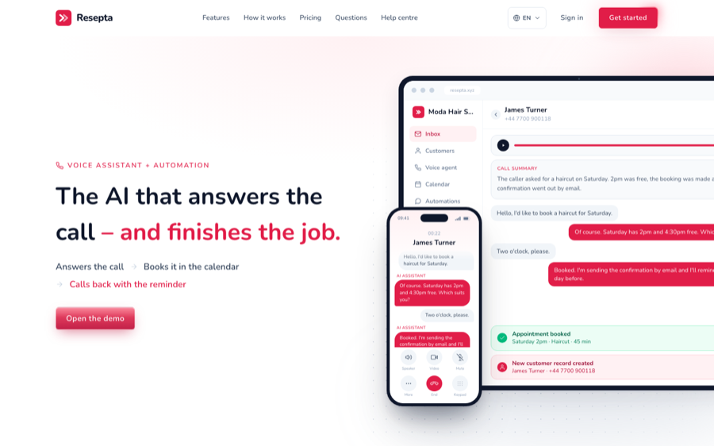

## Hi, I'm Serdar 👋

I build apps, voice agents and automations, for my own products and for clients. Most of what's here started as a fix for something that annoyed me, and a few of those fixes turned into products other people use.

[Website](https://serdarsalim.com) · [Blog](https://blog.serdarsalim.com) · [LinkedIn](https://www.linkedin.com/in/serdarsalim)

### Things I've built

<table>
<tr>
<td width="50%" valign="top">

<h4><a href="https://github.com/serdarsalim/Mana-Personal-AI">Mana</a></h4>
Your own AI office. A self-hosted personal AI for goals, money, people and projects. <a href="https://mana.serdarsalim.com">Try the demo</a>
</td>
<td width="50%" valign="top">

<h4><a href="https://github.com/serdarsalim/randevu">Resepta</a></h4>
AI front desk for salons and clinics. It answers the phone, books the appointment and sends the reminder. <a href="https://resepta.xyz">See it live</a> · <a href="https://github.com/serdarsalim/randevu">Code</a>
</td>
</tr>
<tr>
<td width="50%" valign="top">

<h4><a href="https://github.com/serdarsalim/Multi-Tenant-Blog-CMS">Blog CMS</a></h4>
The self-hosted blog I write on, with a built-in editor and a publish API.
</td>
<td width="50%" valign="top">
<h4>Smaller tools</h4>
<a href="https://github.com/serdarsalim/openport"><b>OpenPort</b></a>: free Mac app that starts, stops and watches all your local dev servers from one window.  
<a href="https://github.com/serdarsalim/Apple-Voice-Memos-Transcriber"><b>Oh Memo</b></a>: search, export and summarize your Apple Voice Memos transcripts.  
<a href="https://github.com/serdarsalim/N8N-Tester-Webapp"><b>n8n studio</b></a>: test and debug n8n workflows with every node's input and output on one screen.
</td>
</tr>
</table>

### Latest writing

<!-- BLOG-POST-LIST:START -->
- [Recursive self improvement](https://blog.serdarsalim.com/posts/recursive-self-improvement-9b8bc364)
- [How I gave Claude and Codex one shared memory](https://blog.serdarsalim.com/posts/how-i-gave-claude-and-codex-one-shared-memory-71c54ba0)
- [When the Rope Runs Out](https://blog.serdarsalim.com/posts/when-the-rope-runs-out-2e6990e5)
- [Justice needs a sword](https://blog.serdarsalim.com/posts/justice-needs-a-sword)
- [My Favorite Istanbul Mosques](https://blog.serdarsalim.com/posts/my-favorite-istanbul-mosques)
<!-- BLOG-POST-LIST:END -->
